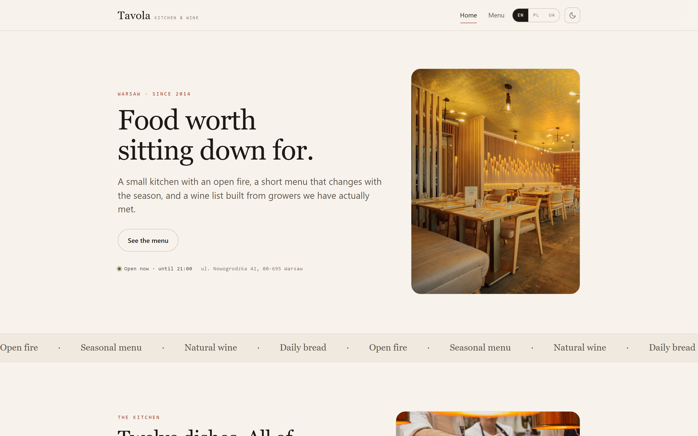
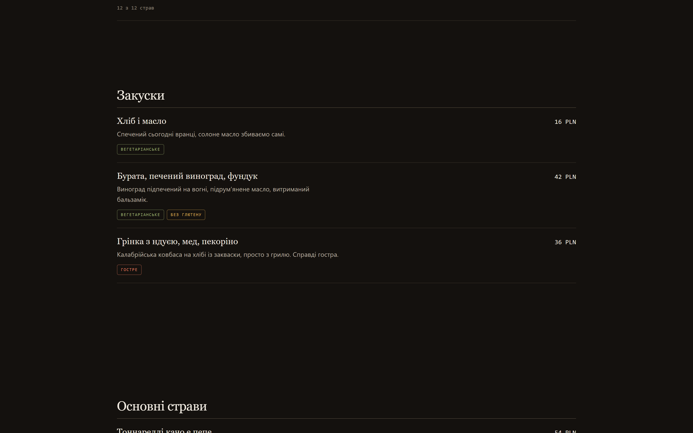

# Tavola Lite — restaurant website in three languages, zero dependencies

A website template for a restaurant, café or wine bar. Open `index.html` and it runs — no npm install, no bundler, no CDN, not even a webfont. It works from a hard drive, from a USB stick, and offline.

Three languages switch in the header: **English, Polish and Ukrainian**. The menu is data, not markup.



**[Live demo](https://Anatolii198.github.io/tavola-lite/)** · light and dark · English / Polish / Ukrainian

---

## What's in here

| Page | What it shows |
|---|---|
| `index.html` | Home — hero, the kitchen, signature plates built from the menu data, opening-hours badge |
| `menu.html` | Menu — courses and diet filters that count live, prices formatted per language |
| `404.html` | Not found |

---

## The menu is data

Twelve dishes live in one array in `js/menu.js`. Not one of them is written into the HTML, so editing the menu never means editing a page.

```js
const MENU = [
  { id: 'burrata', cat: 'starters', price: 42, tags: ['veg', 'gf'], star: true, img: 'img/dish-burrata.jpg' },
  { id: 'turbot',  cat: 'mains',    price: 98, tags: ['gf'],        star: true, img: 'img/dish-turbot.jpg' },
  // …
];
```

`cat` groups it, `tags` feed the diet filters (vegetarian · vegan · gluten-free · spicy), `star` puts it on the home page, `price` is a plain number — the currency comes from the config and is formatted per language.

The file has **two halves on purpose**: `MENU` is what a dish *is*, `MENU_TEXT` is what it is *called*, one block per language. They are joined by `id` at the bottom of the file.

```js
const MENU_TEXT = {
  en: { burrata: { n: 'Burrata, roast grapes, hazelnut', d: 'Grapes blistered over the fire…' } },
  pl: { burrata: { n: 'Burrata, pieczone winogrona, orzech laskowy', d: '…' } },
  uk: { burrata: { n: 'Бурата, печений виноград, фундук', d: '…' } },
};
```

That split is the whole point. When three languages sit inside one dish, side by side, you stop writing a menu and start translating line by line — and a translated menu always reads like one. Written apart, each language gets its own words, and you can hand one block to a native speaker without the English next to it.

A dish missing from a language falls back to English and says so in a console warning, so nothing breaks silently.



---

## Three languages, done properly

Two things give a machine translation away, and both are handled here.

**Plurals.** English has two forms and switches at one. Polish and Ukrainian have three and switch on the last digit — `1 гість`, `3 гості`, `5 гостей`. A key like `menu.count` gets three entries (`…1`, `…2`, `…5`) and the rule picks one:

```js
const SLAVIC = n => {
  const d = n % 10, h = n % 100;
  if (d === 1 && h !== 11) return '1';
  if (d >= 2 && d <= 4 && (h < 12 || h > 14)) return '2';
  return '5';
};
```

**Money and dates.** Prices are stored as a plain number and formatted by `Intl.NumberFormat` per locale: write `42`, and it shows as `42 zł` in Polish and `PLN 42` in English. Dates go through `Intl.DateTimeFormat` the same way.

English text also sits directly in the HTML, so a search engine — and a visitor with JavaScript off — still reads a finished page.

---

## No external requests. None.

No Google Fonts, no analytics, no icon CDN, no tracking pixel. The page asks for nothing but its own files.

That is not a performance brag — it is one less thing to disclose in a privacy policy, one less third party to explain to a client in the EU, and one less service that can be slow or disappear.

---

## Quick start

```bash
git clone https://github.com/Anatolii198/tavola-lite.git
cd tavola-lite
```

Then open `index.html` in a browser. That is the whole setup.

If your browser blocks local files, serve the folder over HTTP:

```bash
python -m http.server 8000
```

---

## Making it yours

Open `js/config.js`. Name, phone, e-mail, address, social links, currency and opening hours are all in that one file; change them once and both pages follow.

```js
const CFG = {
  name: 'Tavola',
  currency: 'PLN',
  hours: {
    1: null,                      // Monday closed
    2: { from: '12:00', to: '23:00' },
    // …
  },
};
```

The opening-hours badge in the hero reads the same object, so "Open now · until 23:00" is never out of sync with the footer table.

---

## Files

```
index.html  menu.html  404.html
css/style.css      one stylesheet, commented by section
js/config.js       everything a restaurant changes
js/i18n.js         interface strings, three languages
js/menu.js         the dishes: structure + text per language
js/main.js         behaviour: language, theme, menu, filters
img/               7 photographs (Unsplash, credits in img/CREDITS.txt)
```

---

## Lite — and the full template

This repository is the free showcase: **3 pages of 8, 12 dishes of 26, 7 photographs of 21**, and no booking form.

The full **Tavola** template adds reservations with a form that knows your opening hours (a closed day is refused, today's past times disappear, large parties are sent to the events page), About, Gallery with a lightbox, Events & catering, Contact, and all 21 photographs.

- Demo of the full template: https://tavola-restaurant-template.netlify.app
- [Payhip](https://payhip.com/b/wdnWV) · [Gumroad](https://tolya89.gumroad.com/l/tavola-restaurant) · [Codester](https://www.codester.com/items/74751/tavola-restaurant-website-template)

---

## License

MIT for the code in this repository — see [LICENSE](LICENSE). Use it, change it, ship it.

The photographs are from [Unsplash](https://unsplash.com/license) under the Unsplash License; sources are listed in `img/CREDITS.txt`. The MIT license above covers the code, not the pictures.
